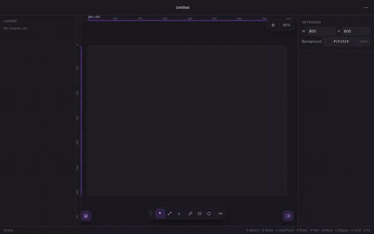
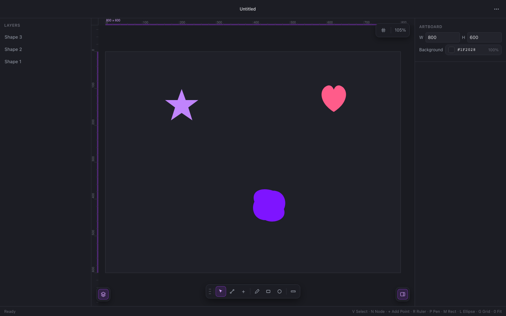

# Boring Vectors

A browser-based SVG editor **and** animator — import or draw vector shapes, edit them down to the bezier node, then key them over time and export the result as an animated SVG, GIF, or video. No install, no account, runs entirely client-side.

Works well as a general vector tool, but it's particularly suited to small, precise work like **animated icons and UI micro-interactions** — one-click artboard presets at common icon sizes, node-level control over every curve, and a keyframe timeline built for short, loopable animations rather than long-form motion graphics.

**[Try it live →](https://boring-vectors.netlify.app/)**



## What it does

- **Draw and import** — pen tool, rectangle/ellipse primitives, paste raw SVG markup, or one-click artboard presets at 16/24/32/48/64/128px
- **Edit precisely** — select/node tools with resize and rotate handles, numeric X/Y/handle inputs, multi-select and multi-node editing, snapping shortcuts (arrow-key nudge, Shift-constrain, Alt-duplicate) matching what you'd expect from Figma or Illustrator
- **Layers panel** — every shape auto-named by its geometry (Rectangle, Ellipse, Line, Shape), renamable, click to select in either direction
- **Keyframe animation** — a Figma-style timeline for opacity, position, size, rotation, scale, and color, with per-keyframe easing
- **Export** — static or animated SVG (native SMIL), PNG/JPG, GIF, WebM video, or a portable project file to reload later



## Dev

```
npm install
npm run dev
```

```
npm test          # Vitest unit tests
npm run test:e2e  # Playwright end-to-end suite
npm run build
```

## Stack

Vite + React 18 + TypeScript, [Paper.js](http://paperjs.org/) for the canvas scene graph, Zustand for UI state.

See [`docs/SPEC.md`](docs/SPEC.md) for the original brief and feature inventory, and [`docs/ROADMAP.md`](docs/ROADMAP.md) for a running log of everything built after the initial parity pass (projects, animation, export, multi-select, Select/Node tool parity) and the reasoning behind it.
